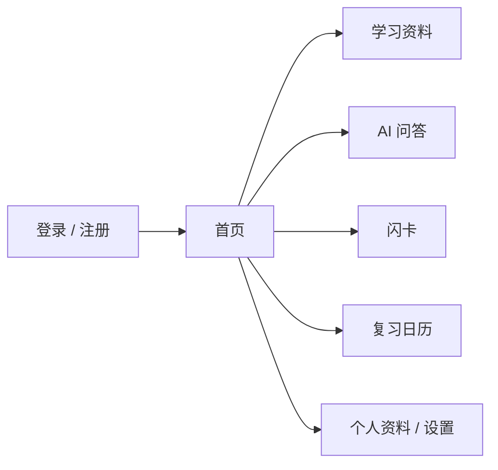

# MemoCard AI 前端设计方案

**状态：** 视觉方向已获开发者确认；前端依赖与应用代码尚待单独批准

**范围：** 产品视觉方向、信息架构、页面密度、角色素材使用和交互动效。此文件是设计记录，不包含应用界面代码，也不批准任何前端依赖。

## 1. 设计目标

让学生一眼看懂当前要做什么。页面保持整齐、安静、易扫读；每个页面有一个主要任务。次要内容通过明确命名的按钮、折叠区或详情面板按需显示，避免把所有控制和信息同时铺开。

### 设计原则

- 固定一致的导航、标题、内容边距和间距规则。
- 一个页面只设一个视觉主操作；其他操作降低视觉权重。
- 首页显示少量摘要和下一步入口，不复制其他模块的全部内容。
- 默认展示完成当前任务所需的信息；高级选项放在按钮之后。
- 用文字、图标和位置共同表达状态，不只依靠颜色。
- 电脑端和手机端都保持清楚的阅读顺序，不横向挤压桌面布局。
- 相关信息按标题、分组、细分隔线和固定列对齐归类；不要连续堆叠一排功能卡片。
- 每组内容只展示完成当前任务需要的信息；更多设置通过明确命名的按钮展开。

## 2. 品牌视觉方向

### 气质

「白色学习工作台 + 柔和蓝色渐变」：整体以白色内容表面为主，登录介绍区与登录后的工作区使用同一组浅蓝渐变，形成连续的品牌背景；表单和主要内容仍放在清楚的白色表面上。界面吸收 iOS 的层级、细分隔线和克制反馈，不复制 Apple 的专有图标或界面。

### 暂定设计令牌

| 用途 | 暂定颜色 | 使用方式 |
|---|---|---|
| 页面底色 | `#F5F5F7` | 极浅冷灰，只用于页面底衬 |
| 品牌渐变 | `#EFF5FF → #DCE9FF → #EDF0FF` | 登录介绍区和已登录工作区共用；可叠加很淡的蓝色光晕 |
| 内容表面 | `#FFFFFF` | 表单、明确的内容区 |
| 主文字 | `#1D1D1F` | 标题和正文 |
| 次要文字 | `#6E6E73` | 辅助说明、时间和次要状态 |
| 主操作 | `#2878E3` | 主按钮、当前导航状态；少量使用 |
| 分隔线 | `#E5E5EA` | 列表和区域分组，不围住每个元素 |
| 错误状态 | `#B94742` | 错误和需要处理的问题 |

颜色是讨论起点；实现前应检查文字与背景的对比度。白色表面优先靠间距和细分隔线分组；圆角、模糊和阴影只用于确实悬浮或可操作的层，不把每个区域都做成卡片。iOS 感来自清楚的层级和细致反馈，不靠到处铺玻璃效果。

### 字体和节奏

- 使用系统中文字体栈，避免为了字体额外请求外部服务。
- 正文建议 16px 左右，辅助文字不小于 12px；标题按层级递进。
- 采用 8px 间距基准：紧密元素 8px，相关区块 16px，主要区块 24–32px。
- 桌面内容最大宽度约 1200px；表单和阅读内容使用更窄的宽度，避免长行。

## 3. 角色素材使用

- 登录页不放角色图片，也不绘制替代吉祥物；视觉焦点由品牌文字和蓝色渐变承担。
- 登录后首页的“继续今天的复习”区域使用开发者提供的第二张布里布里左卫门手绘图，保持原图，不重绘。
- 第一张近景图不使用。其他页面不额外添加角色图，避免界面拥挤。

## 4. 页面结构和内容上限

### 全局应用框架

桌面采用左侧固定主导航，右侧为当前工作区。导航项间距一致；页面内容按标题、主操作、主要任务、次要详情的顺序纵向排列。相关数据用分组标题和细分隔线归类，不用卡片把所有区块框起来。个人资料、设置和登出放在头像菜单，不占据主导航空间。

```text
┌──────────────────┬────────────────────────────────────────────┐
│ MemoCard AI      │ 页面标题                         主操作按钮 │
│ 首页             ├────────────────────────────────────────────┤
│ 学习资料         │ 当前页面主要任务                           │
│ AI 问答          │                                            │
│ 闪卡             │ 次要内容按需通过按钮、折叠区或详情打开     │
│ 复习日历         │                                            │
│                  │                                            │
│ 头像 / 设置      │                                            │
└──────────────────┴────────────────────────────────────────────┘
```

手机端把侧栏收成菜单；主要操作保持容易点击。列表在窄屏改成纵向项目，不强迫用户横向滚动宽表格。



### 页面分工

| 页面 | 默认只显示 | 次要内容的入口 |
|---|---|---|
| 登录 / 注册 | 品牌说明、当前选中的表单、错误提示、切换登录/注册入口 | 不放角色图或学习面板 |
| 首页 | 今日复习入口、一个继续学习入口、少量近期活动 | 近期活动最多显示几项，完整记录另开页面 |
| 学习资料 | 上传按钮、资料列表、处理状态 | 单份资料的详情和删除等操作放在行菜单/详情面板 |
| AI 问答 | 对话、提问框、回答来源摘要 | 资料范围通过“选择资料”按钮打开；引用通过“查看来源”展开 |
| 闪卡 | 闪卡集合列表和“开始复习”主操作 | 新建、编辑和集合设置放入单独表单/详情页 |
| 复习日历 | 默认显示近期到期任务列表 | 月历通过“月历视图”切换；不把完整月历和长任务列表同时堆在首页 |
| 个人资料 | 姓名、邮箱、保存 | 安全设置只在用户打开时显示 |

### 核心页面草图

```text
首页：  [早上好]                         [继续学习]
        [今日到期 8 张] [资料处理状态简报]
        [接下来复习的几张卡]
        [最近打开的资料]

AI问答：[对话标题]                      [选择资料 ▾]
        [提问与回答，来源可展开]
        [在这里输入问题……             发送]

闪卡：  [集合名称]                       [开始复习]
        [问题卡片，一次显示一张]
        [显示答案] → [忘了] [困难] [记住了]
```

首页指标只保留能帮助用户决定下一步的内容，不为填满版面增加无关统计卡片。

## 5. 动效与按钮反馈

动效用来说明状态变化和操作结果，不能延迟用户完成任务。

| 场景 | 建议动效 | 限制 |
|---|---|---|
| 页面切换 | 内容淡入并轻移约 4–6px，140–180ms | 不做整页弹跳；不延迟可操作状态 |
| 按钮悬停 / 按下 | 悬停轻微提亮；按下缩至约 98%，100–140ms | 按钮很多、使用频繁，所以只做短反馈，不每次都弹跳 |
| 菜单、弹窗、抽屉 | 轻微弹簧进入，约 200–300ms；弹性很小 | 从触发按钮附近展开；Esc 可立即关闭并还焦点 |
| 资料引用展开 | 高度和透明度平滑变化，约 160–200ms | 默认收起；不让阅读中的正文移动 |
| 闪卡翻面 | 单次翻面，约 280–340ms，可带轻微回弹 | 只翻卡片本身，答案按钮保持稳定 |
| 操作成功 / 空状态 | 成功标记轻轻弹一下，约 300–450ms | 只用于低频、有意义的时刻，不循环播放 |

采用“常态平稳、动作触发时有弹性”的节奏：按钮按下有即时触感，菜单和抽屉轻微弹簧展开；页面切换和大块正文不做明显回弹。Apple 的界面指南强调动效应传达反馈或状态，避免无目的的重复动画；动效 skill 也建议把弹跳留给低频和带真实手势的交互。全站支持 `prefers-reduced-motion`：减少动态效果时关闭回弹、翻转和非必要位移。加载时优先固定布局空间，避免内容跳动。

### 所有控件都遵守

- 有默认、悬停、按下、键盘焦点、加载、禁用和错误状态。
- 主按钮在同一操作组里最多一个；危险操作使用清楚的文字确认。
- 图标按钮必须有可读名称；键盘焦点清晰可见。
- 触屏按钮有足够点击面积；动画不作为状态的唯一提示。

## 6. 前端和认证 API 的连接

首版建议让 React 页面和 FastAPI `/api` 函数位于同一个 Vercel 项目/域名：前端使用相对路径调用 `/api/auth/...`，请求携带 HttpOnly Cookie；数据库仍使用已定义的 `users` 与 `auth_sessions`，无需新增表。Vercel 文档说明根目录 `api/` 可承载 Functions；Vite 可将 React 构建为静态资源。这个同源方案避免首版先引入跨域 Cookie 与 CORS 配置。

如之后选择分离域名，必须重新设计跨域 Cookie、CORS 和 CSRF 防护后再部署。Vercel Services 的多服务方案目前仍有 Beta 状态，因此不把它作为本设计的前置条件。

## 7. 建议的实现顺序

1. 已确认视觉方向：文字式渐变蓝登录页、统一的登录后工作区渐变、第二张原图用于首页复习卡。
2. 单独批准 React 与 Vite 构建依赖后，建立前端基础并实现认证页面。
3. 用真实 API 连接注册、登录、个人资料和退出流程；确认环境配置后再做部署验证。
4. 每完成一块先验证、给你审核，再按约定创建本地 Commit；Push 仍单独等待批准。

本设计没有选择额外 UI 框架、图标库、路由库、字体服务或动画库。CSS 动效、页面过渡和基本表单状态先用原生 CSS/React 实现。

## 8. 参考原则

- [Apple Human Interface Guidelines — Motion](https://developer.apple.com/design/human-interface-guidelines/motion)：动效应传达反馈、状态或空间关系，避免无目的和过量动画。
- [Apple Human Interface Guidelines — Materials](https://developer.apple.com/design/human-interface-guidelines/materials)：材料效果应帮助区分界面层级并维持可读性；本项目借鉴层级原则，不直接复刻平台材料。
- [Emil Kowalski — Design Engineering skill](https://github.com/emilkowalski/skills/blob/main/skills/emil-design-eng/SKILL.md)：按钮反馈与弹簧回弹保持短促、有目的，日常操作不应变成装饰动画。
- [Codex 前端设计 skill（社区移植版）](https://github.com/dobromirdikov/codex-frontend-design-skill)：先确定视觉方向、内容层级和响应式检查，再进入具体页面实现。这里只参考工作方法，不把外部 skill 当作项目规则。
